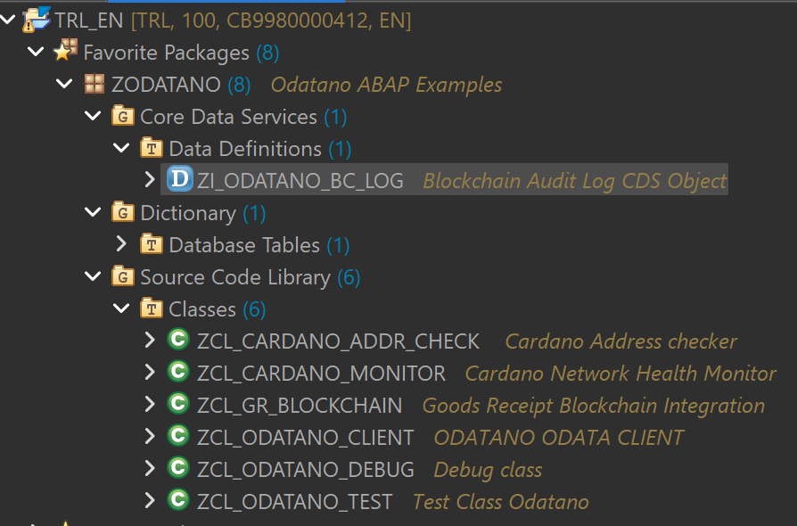
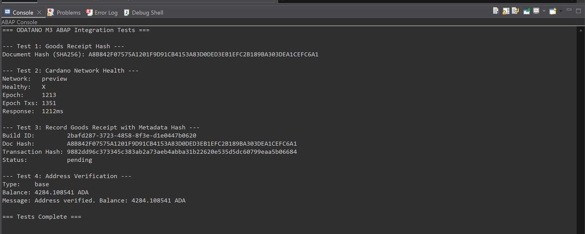

# ODATANO ABAP Integration Examples

ABAP Cloud examples that call the ODATANO OData V4 API from SAP business processes. They target the
**SAP BTP ABAP Environment** and follow the ABAP RESTful Application Programming Model (RAP).

## Architecture


## Objects Overview

### Database Table

| Object | Description |
|--------|-------------|
| `ZODATANO_BC_LOG` | Blockchain audit log: document hashes, transaction references and status |

### CDS View

| Object | Description |
|--------|-------------|
| `ZI_ODATANO_BC_LOG` | Root view entity on the audit log table for RAP/OData exposure |

### ABAP Classes

| Class | Description |
|-------|-------------|
| `ZCL_ODATANO_CLIENT` | HTTP client for the ODATANO OData V4 API (read and transaction endpoints) |
| `ZCL_GR_BLOCKCHAIN` | Supply chain scenario: records goods receipts on Cardano with a SHA-256 hash as metadata |
| `ZCL_CARDANO_MONITOR` | Operations scenario: reads the Cardano network status and tracks the response time |
| `ZCL_CARDANO_ADDR_CHECK` | Procurement scenario: checks a Cardano address and its balance before a payment is released |
| `ZCL_ODATANO_TEST` | Console application (`if_oo_adt_classrun`) that runs all scenarios |

## Integration Scenarios

### 1. Supply Chain – Goods Receipt Blockchain Anchoring

When goods arrive at a plant, the system computes a SHA-256 hash of the receipt data. It writes the hash
to Cardano as transaction metadata through ODATANO. Auditors and trading partners can check the receipt
against the hash on their own.

**Flow:**
```
SAP Goods Receipt → SHA-256 Hash → ODATANO BuildTransactionWithMetadata → External Signing → Submit → Audit Log
```

**ODATANO API:** `POST /odata/v4/cardano-transaction/BuildTransactionWithMetadata`

### 2. Network Health Monitoring

A class reads the Cardano network status through ODATANO and tracks the response time. Use it to check
that the chain is reachable before a supply chain transaction runs.

**ODATANO API:** `POST /odata/v4/cardano/GetNetworkInformation`

### 3. Address Verification for Procurement

Before a payment is released, the system checks that the recipient's Cardano address exists on chain. A
minimum balance can be checked as well. The check fits into a payment approval workflow.

**ODATANO API:** `POST /odata/v4/cardano/GetAddressByBech32`

## Prerequisites

- SAP BTP ABAP Environment (Trial or Licensed)
- Eclipse with ADT (ABAP Development Tools)
- ODATANO service deployed and reachable from BTP (e.g. on Cloud Foundry)

## Setup

### 1. Create ABAP Objects

1. Create an ABAP package (e.g. `Z_ODATANO`)
2. Create all objects in order:
   - `ZODATANO_BC_LOG` (Database Table)
   - `ZI_ODATANO_BC_LOG` (CDS View)
   - `ZCL_ODATANO_CLIENT` (HTTP Client)
   - `ZCL_GR_BLOCKCHAIN` (Goods Receipt Logic)
   - `ZCL_CARDANO_MONITOR` (Network Monitor)
   - `ZCL_CARDANO_ADDR_CHECK` (Address Verification)
   - `ZCL_ODATANO_TEST` (Test Console App)
3. Update the ODATANO service URL and credentials in `ZCL_ODATANO_TEST`
4. Run with **Right-click → Run As → ABAP Application (Console)**

### Example Package Structure after creation:



### 2. Get XSUAA Credentials (OAuth2 Token)

XSUAA protects the deployed ODATANO service. An ABAP caller needs OAuth2 client credentials:

```bash
# Create a service key for the XSUAA instance (one-time)
cf create-service-key odatano-auth odatano-sk

# Read the credentials
cf service-key odatano-auth odatano-sk
```

This returns:

```json
{
  "clientid": "sb-odatano-...",
  "clientsecret": "...",
  "url": "https://<subdomain>.authentication.<region>.hana.ondemand.com"
}
```

Use these values when instantiating `ZCL_ODATANO_CLIENT`:

| ABAP Parameter | Value |
|----------------|-------|
| `iv_base_url` | Your `odatano-srv` URL (e.g. `https://...-odatano-srv.cfapps.us10-001.hana.ondemand.com`) |
| `iv_token_url` | `{url}/oauth/token` from the service key |
| `iv_client_id` | `clientid` from the service key |
| `iv_client_secret` | `clientsecret` from the service key |

The client fetches a Bearer token with the OAuth2 client credentials flow and caches it. `xs-security.json`
gives such a token the scopes `Read`, `Transact` and `Sign`. The scenarios use `Read` and `Transact`.

## Running the Tests

The test console app (`ZCL_ODATANO_TEST`) includes four tests:

| Test | Requires ODATANO | Description |
|------|-------------------|-------------|
| 1 – Document Hashing | No | Computes the SHA-256 hash of a sample goods receipt |
| 2 – Network Health | Yes | Reads the Cardano network status through ODATANO |
| 3 – Goods Receipt Recording | Yes | Full flow: hash → build metadata transaction → audit log |
| 4 – Address Verification | Yes | Verifies a Cardano testnet address |

Tests 2 to 4 report a connection error and go on when ODATANO is not reachable.

## Example Output


