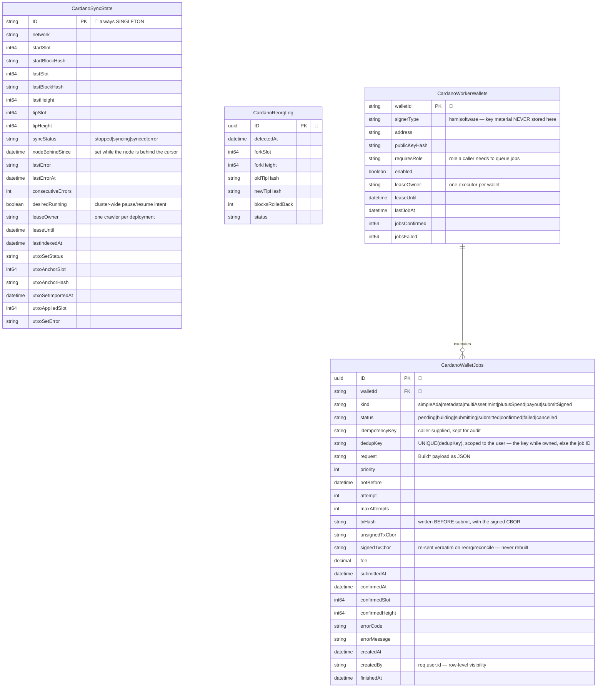

# ODATANO Data Model

The diagrams show the entities a client reads most often, with their main fields. `db/schema.cds` is the
reference and has all 52 entities.

Not drawn: Assets, AssetHistory, LedgerProtocolParameters, the epoch snapshots (PoolEpochSnapshots,
DrepEpochSnapshots, EpochLedgerSnapshots, AccountEpochSnapshots), TransactionCertificates,
TransactionWithdrawals, TransactionRedeemers, TransactionDatums, the crawler-fed UTxO set (LedgerUTxOs,
LedgerUTxOAssets, LedgerAddresses, LedgerAddressAssets, LedgerAccounts), TransactionBuildRedeemers,
CardanoAgentGrants and CardanoAgentGrantUsage.

## Chain data, builds and signing

```mermaid
---
config:
  theme: base
  themeVariables:
    primaryColor: "#0C5ECF"
    primaryTextColor: "#001840"
    primaryBorderColor: "#001840"
    lineColor: "#001840"
    secondaryColor: "#4d7bc5"
    tertiaryColor: "#0C5ECF"
    mainBkg: "#0C5ECF"
    nodeBorder: "#001840"
    clusterBkg: "#001840"
    clusterBorder: "#001840"
    titleColor: "#001840"
    edgeLabelBackground: "#0C5ECF"
    textColor: "#001840"
    background: "#4d7bc5"
    fontSize: "13px"
    fontFamily: "monospace"
    attributeBackgroundColorEven: "#4d7bc5"
    attributeBackgroundColorOdd: "#4d7bc5"
  er:
    layoutDirection: "TB"
    fontSize: 12
    useMaxWidth: false
    fill: "#0C5ECF"
    stroke: "#0C5ECF"
---

erDiagram
    NetworkInformation {
        string network PK "🔑"
        decimal maxSupply
        decimal totalSupply
        decimal circulatingSupply
        decimal lockedSupply
        decimal treasurySupply
        decimal reservesSupply
        decimal liveStake
        decimal activeStake
    }

    Epochs {
        int epoch PK "🔑"
        int startTime
        int endTime
        int firstBlockTime
        int lastBlockTime
        int blockCount
        int txCount
        string output
        decimal fees
        decimal activeStake
        boolean final "ended and past the rollback horizon"
    }

    Blocks {
        string hash PK "🔑"
        datetime time
        int height
        string slotLeader
        int epochNumber FK "🔗"
        long slot
        int epochSlot
        int size
        int txCount
        decimal fees
        string previousHash "parent block, null when unknown"
        boolean withdrawalsReported "every tx reported its withdrawals"
    }

    Pools {
        string poolId PK "🔑"
        string vrfKeyHash
        int blocksMinted
        int blocksEpoch
        decimal liveStake
        decimal liveSize
        decimal liveSaturation
        int liveDelegators
        decimal activeStake
        decimal activeSize
        decimal pledge
        decimal margin
        decimal fixedCost
        string rewardAccount
        string metadataUrl
        string metadataHash
        string name
        string ticker
        string homepage
        string description
    }

    Dreps {
        string drepId PK "🔑"
        string hex
        decimal amount
        boolean hasScript
        int lastActiveEpoch
        boolean retired
        boolean expired
    }

    Addresses {
        string address PK "🔑"
        string stakeAddress
        string type
        boolean isScript
        decimal totalLovelace
        int utxoCount
        boolean hasTransactions
        boolean hasAssets
        boolean hasUTxOs
    }

    Accounts {
        string stakeAddress PK "🔑"
        boolean active
        int activeEpoch
        decimal controlledAmount
        decimal rewardsSum
        decimal withdrawalsSum
        decimal reservesSum
        decimal treasurySum
        decimal withdrawableAmount
        string poolId FK "🔗"
        string drepId FK "🔗"
        boolean hasAddresses
        int addressCount
        string addressList "JSON, sorted; not in the read projection"
    }

    AddressAssets {
        string address FK "🔗"
        string unit
        decimal quantity
        string policyId
        string assetNameHex
        string assetName
        string fingerprint
    }

    AddressUTxOs {
        string address FK "🔗"
        string hash
        int index
        string blockHash
        decimal lovelace
        string dataHash
        string inlineDatum
        string referenceScriptHash
        integer referenceScriptSize
        string referenceScriptType
        string paymentCredential
        boolean hasAssets
    }

    UTxOAssets {
        string utxo FK "🔗"
        string unit
        decimal quantity
        string policyId
        string assetNameHex
        string assetName
        string fingerprint
    }

    Transactions {
        string hash PK "🔑"
        long txSeq "slot * 65536 + txIndex"
        string blockHash
        int blockHeight
        long blockTime
        long slot
        int txIndex
        decimal fee
        decimal deposit
        int size
        boolean hasMetadata
        boolean hasInputs
        boolean hasOutputs
    }

    TransactionMetadata {
        long id PK "🔑"
        string tx FK "🔗"
        string label
        string payload
        long txSeq
    }

    TransactionInputs {
        long txSeq FK "🔗"
        int inputIndex
        string address FK "🔗"
        string dataHash
        string inlineDatum
        string referenceScriptHash
        integer referenceScriptSize
        string referenceScriptType
        string paymentCredential
        string spentTxHash
        int spentOutputIndex
        long spentTxSeq
        boolean isCollateral
        boolean isReference
        boolean hasAddresses
        boolean hasAssets
    }

    TransactionOutputs {
        long txSeq FK "🔗"
        int outputIndex
        string address FK "🔗"
        string dataHash
        string inlineDatum
        string referenceScriptHash
        integer referenceScriptSize
        string referenceScriptType
        string paymentCredential
        boolean hasAddresses
        boolean hasAssets
    }

    TransactionInputAssets {
        string input FK "🔗 view"
        string unit
        decimal quantity
        string policyId
        string assetNameHex
        string assetName
        string fingerprint
    }

    TransactionInputAssetCopies {
        string input FK "🔗"
        string unit
        decimal quantity
        string policyId
        string assetNameHex
        string assetName
        string fingerprint
    }

    TransactionOutputAssets {
        string output FK "🔗"
        string unit
        decimal quantity
        string policyId
        string assetNameHex
        string assetName
        string fingerprint
    }

    TransactionBuilds {
        uuid id PK "🔑"
        string network
        string builderEngine
        string senderAddress
        string changeAddress
        string unsignedTxCbor
        string txBodyHash
        decimal fee
        int size
        long createdAt
        string scriptHash
        string mintScriptHash
        string fingerprint
        string scriptAddress
        boolean hasInputs
        boolean hasOutputs
        boolean wasSubmitted
        datetime validFrom
        datetime validTo
    }

    TransactionBuildInputs {
        uuid build FK "🔗"
        int inputIndex
        string txHash
        int outputIndex
        string address
        decimal lovelace
        boolean hasAssets
    }

    TransactionBuildInputAssets {
        uuid input FK "🔗"
        string unit
        decimal quantity
        string policyId
        string assetNameHex
        string assetName
    }

    TransactionBuildOutputs {
        uuid build FK "🔗"
        int outputIndex
        string address
        decimal lovelace
        boolean isChange
        boolean hasAssets
    }

    TransactionBuildOutputAssets {
        uuid output FK "🔗"
        string unit
        decimal quantity
        string policyId
        string assetNameHex
        string assetName
    }

    TransactionSubmissions {
        uuid id PK "🔑"
        uuid build FK "🔗"
        string signedTxCbor
        string txHash
        long submittedAt
        string status "pending|submitted|confirmed|failed"
        string errorCode
        string errorMessage
        int retryCount
        boolean hasErrors
    }

    TransactionSubmissionErrors {
        uuid id PK "🔑"
        uuid submission FK "🔗"
        long occurredAt
        string errorType
        string errorCode
        string errorMessage
        string errorDetails
        boolean isRecoverable
    }

    SigningRequests {
        uuid id PK "🔑"
        uuid build FK "🔗"
        string txBodyHash
        string unsignedTxCbor
        string network
        string status "pending|signed|verified|submitting|submitted|expired|failed"
        string cardanoCliCommand
        string signedTxCbor
        string signerType
        string signerInfo
        string hsmKeyId
        string errorMessage
        datetime createdAt
        datetime expiresAt
        datetime signedAt
        datetime submittedAt
    }

    SignatureVerifications {
        uuid id PK "🔑"
        uuid signingRequest FK "🔗"
        string signedTxCbor
        boolean isValid
        string txBodyHash
        int witnessCount
        string signerKeyHashes
        string errorMessage
        string warnings
        datetime verifiedAt
    }

    AddressSigningRequests {
        string address FK "🔗"
        uuid signingRequest FK "🔗"
    }

    AddressTransactionBuilds {
        string address FK "🔗"
        uuid txBuild FK "🔗"
    }

    AddressTransactions {
        string address FK "🔗"
        string tx FK "🔗"
        decimal netAmount
        long blockTime
        string netAssets
        boolean hasAssets
    }

    Epochs ||--o{ Blocks : "has"
    Addresses ||--o{ AddressAssets : "contains"
    Addresses ||--o{ AddressUTxOs : "contains"
    AddressUTxOs ||--o{ UTxOAssets : "contains"
    Accounts ||--o{ Addresses : "controls"
    Accounts }o--|| Pools : "delegatesTo"
    Accounts }o--|| Dreps : "votesWith"
    Transactions ||--o{ TransactionMetadata : "has"
    Transactions ||--o{ TransactionInputs : "has"
    Transactions ||--o{ TransactionOutputs : "has"
    TransactionInputs ||--o{ TransactionInputAssets : "contains"
    TransactionInputs ||--o{ TransactionInputAssetCopies : "stores"
    TransactionOutputs ||--o{ TransactionOutputAssets : "contains"
    Addresses ||--o{ TransactionInputs : "references"
    Addresses ||--o{ TransactionOutputs : "references"
    TransactionBuilds ||--o{ TransactionBuildInputs : "has"
    TransactionBuilds ||--o{ TransactionBuildOutputs : "has"
    TransactionBuildInputs ||--o{ TransactionBuildInputAssets : "contains"
    TransactionBuildOutputs ||--o{ TransactionBuildOutputAssets : "contains"
    TransactionSubmissions ||--o{ TransactionSubmissionErrors : "has"
    SigningRequests }o--|| TransactionBuilds : "references"
    TransactionSubmissions }o--|| TransactionBuilds : "submits"
    SigningRequests ||--o{ SignatureVerifications : "has"
    Addresses ||--o{ AddressSigningRequests : "has"
    AddressSigningRequests }o--|| SigningRequests : "references"
    Addresses ||--o{ AddressTransactionBuilds : "has"
    AddressTransactionBuilds }o--|| TransactionBuilds : "references"
    Addresses ||--o{ AddressTransactions : "has"
    AddressTransactions }o--|| Transactions : "references"
```

Input and output rows are keyed by `txSeq` and their index. `TransactionInputAssets` is a view: the assets
of an input come from its rows in `TransactionInputAssetCopies`, or from the output it spent, which
`spentTxSeq` and `spentOutputIndex` name.

## Crawler and wallet worker

These four entities reference no chain entity. The crawler writes blocks and transactions into the tables
above and keeps its cursor here. The tables of the worker hold wallets and jobs.

Two parts of this model keep a payment from happening twice:

- **`dedupKey` with `UNIQUE(dedupKey)`.** While a job owns an idempotency key, `dedupKey` holds that key,
  scoped to the user who queued it, across all wallets and kinds. Otherwise it holds the ID of the job. Two jobs with the same key cannot both be inserted,
  and jobs without a key never collide. A cancelled job, and a job that failed before its transaction was
  sent, give the key back.
- **`status = submitting`.** `txHash` and `signedTxCbor` are written before the transaction reaches a
  backend. The job is not finished in that status, so it keeps its idempotency key. After a crash the
  worker checks the chain for the transaction and does not fail the job.
