# SAP Integration Examples

**Version:** v2.0.0-rc.x

How SAP systems use the ODATANO services: BTP deployment, SAP Build Process Automation, the wallet viewer
app and ABAP.

## Overview

ODATANO serves Cardano data and transactions as OData V4 services. Every SAP system that consumes OData
can call them:

- **SAP S/4HANA** (on-premise and Cloud)
- **SAP BTP** (Business Technology Platform)
- **SAP Fiori / UI5** applications
- **ABAP-based systems** (ECC, BW, etc.)

A caller needs a login with the role of the service it calls: `Read` for chain data, `Transact` to build
and submit, `Sign` for the signing service. On BTP the role templates `CardanoReader`, `CardanoUser` and
`CardanoAdmin` carry them. See the [Security Guide](SECURITY_GUIDE.md).

## General Architecture


## BTP Deployment

ODATANO runs on SAP BTP as a Cloud Foundry application. The
[Production Deployment Guide](PRODUCTION_DEPLOYMENT.md) describes the deployment.

### Service Catalog in SAP BTP Cockpit

Set up the BTP environment and create a HANA instance before the deployment.

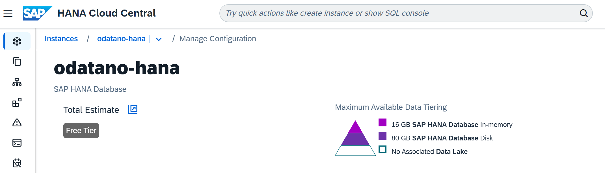

After the deployment the OData service and the wallet viewer app appear in the dev space.

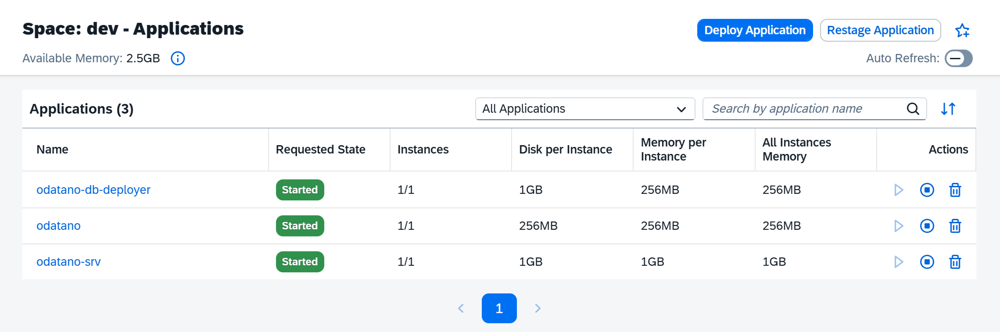

### OData Destination Binding

Create a destination in BTP and bind it to your service instance. SAP applications reach the ODATANO
services through it.

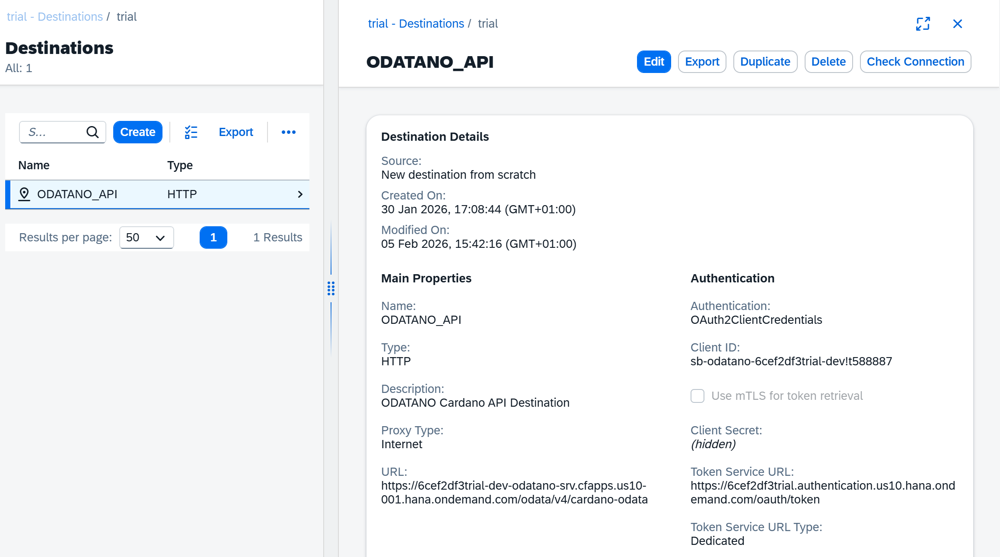

## Use API in SAP Build Process Automation

1. Add the destination, `ODATANO_API` in this example, to your Process Automation project.

   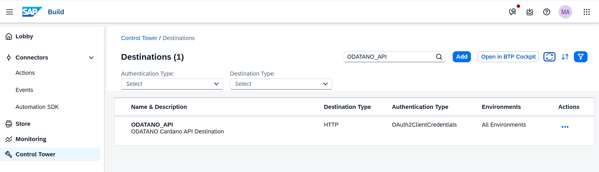

2. Add ODATANO as an action in your workflow.

   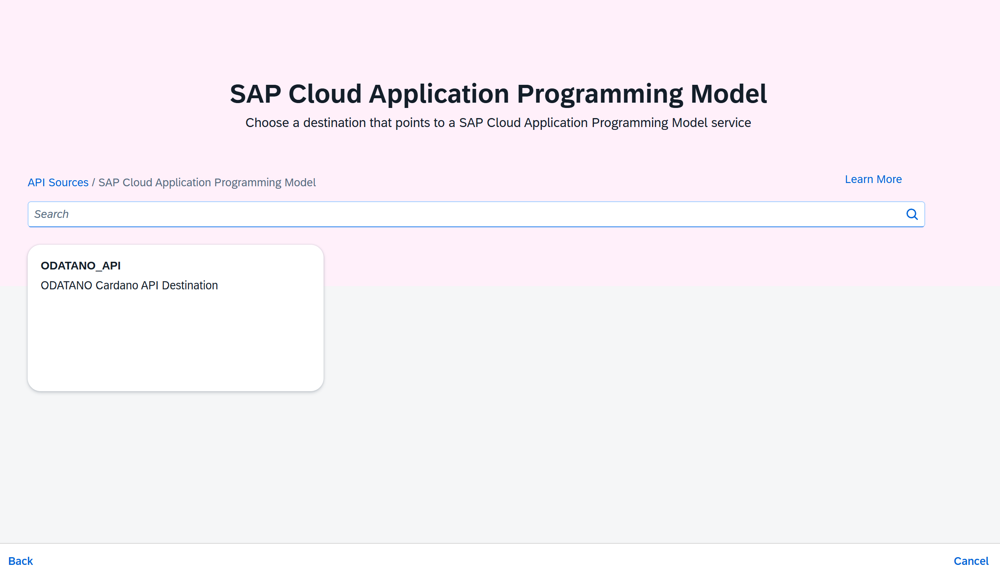

3. Pick the OData actions the workflow needs, for example the one that reads a block or a transaction.

   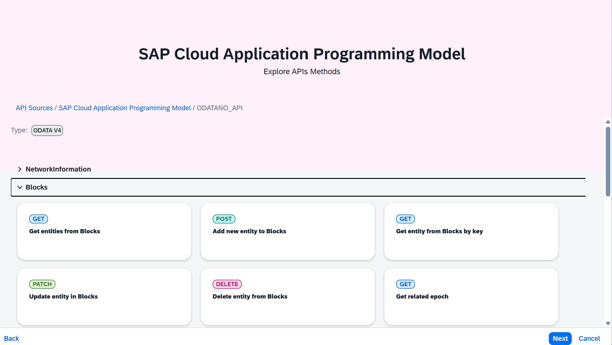

## Reacting to on-chain events instead of polling

The scenario below polls for the confirmation of a transaction. A CAP application that embeds
`@odatano/core` can subscribe instead:

```js
const worker = await cds.connect.to('CardanoWorkerService');
worker.on('jobConfirmed', ({ data }) => { /* data.jobId, data.txHash — settle the business object */ });
worker.on('jobFailed',    ({ data }) => { /* data.errorCode, data.errorMessage */ });
```

- A transaction submitted through the wallet worker needs no polling loop.
- For a transaction submitted directly, the `blockIndexed` event of `CardanoIndexerService` carries the
  transaction hashes of each crawled block. It needs the crawler.

## Example SAP Build Automation Scenario - ADA Invoice Check

A customer pays in ADA and submits the transaction hash. The workflow reads the transaction and starts the
follow-up processing.

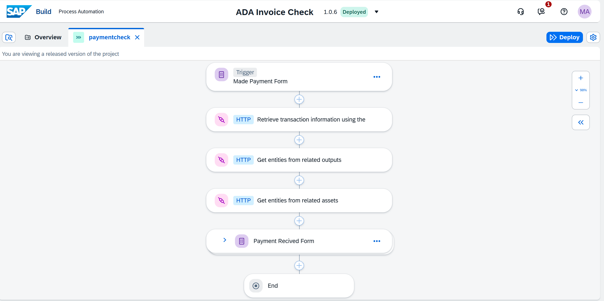

The trigger is a form behind a public link. The customer enters the details of the payment there.

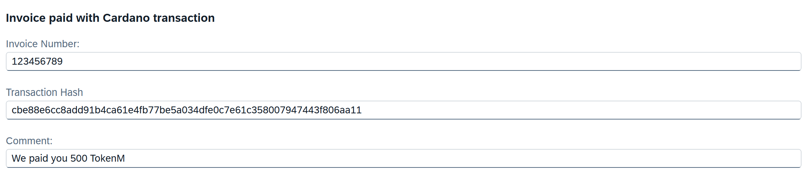

The workflow reads the transaction with its outputs and assets from the chain. It then sends a notification
with these details to your SAP inbox, where you check and confirm the payment.

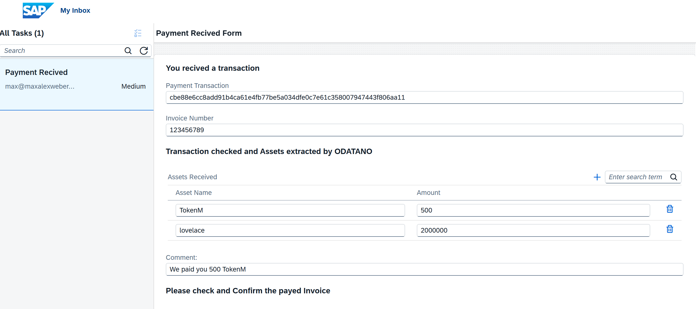

### Wallet Viewer Fiori App

The sample wallet viewer app on BTP:

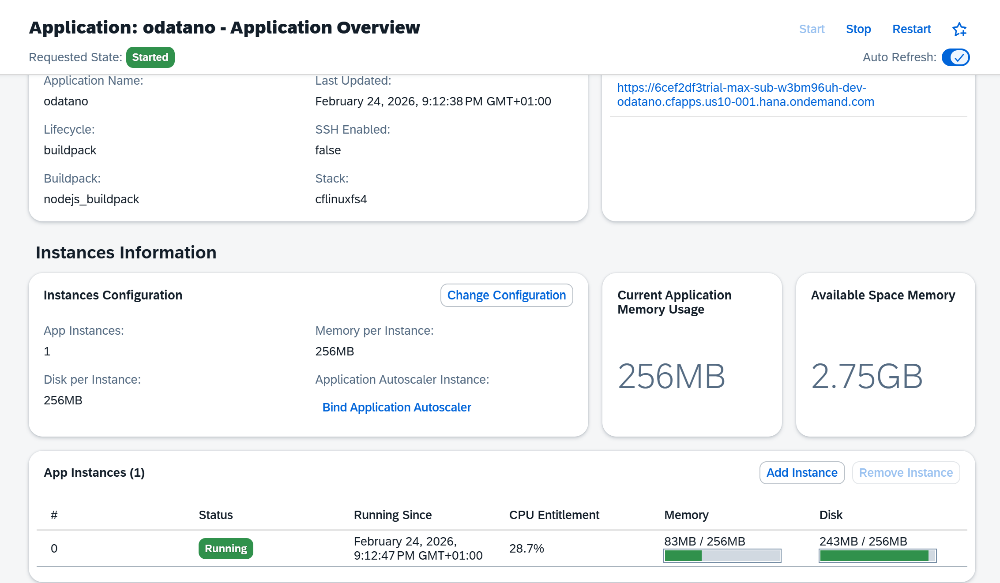

Connect the app to an installed CIP-30 wallet, for example Eternl, Lace or Vespr, or paste a Cardano
address. The app shows the transactions of the address. With a connected wallet it also builds
transactions and submits them through ODATANO.

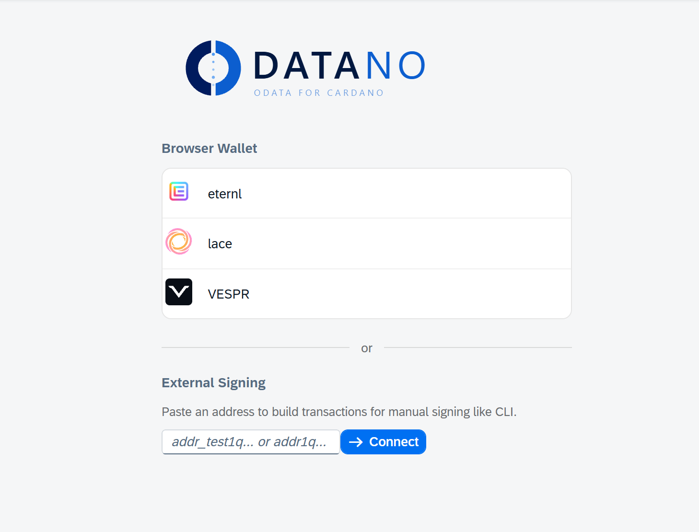

### Transaction Flow with CIP-30 Wallet Signing

1. **Build.** The user picks a transaction template and clicks "Build Transaction". The app calls ODATANO
   to build the transaction.

   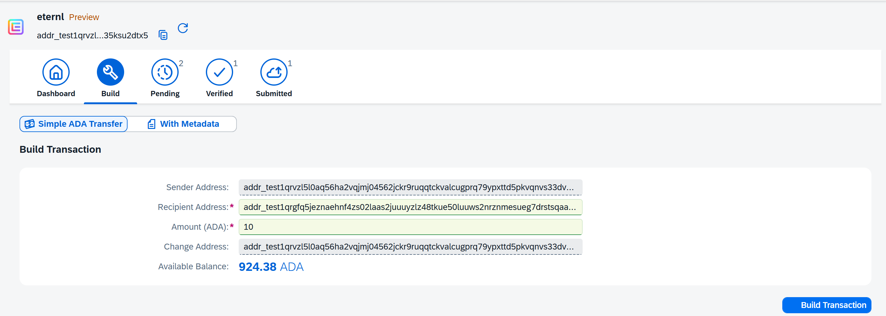

2. **Review.** The app shows the build result, or the error if the build failed.

   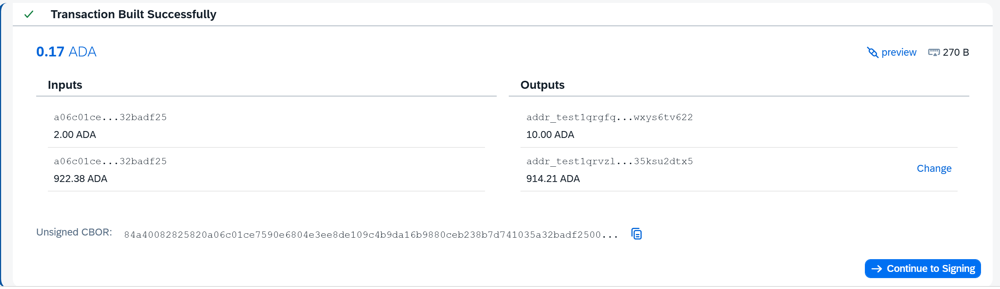

3. **Inspect.** The transaction inspector shows the details of the transaction.

   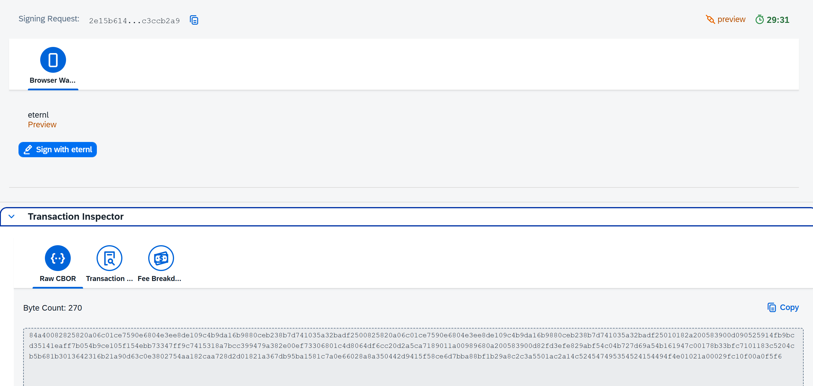

4. **Sign.** The user approves the transaction in the wallet. The wallet returns its signature.

   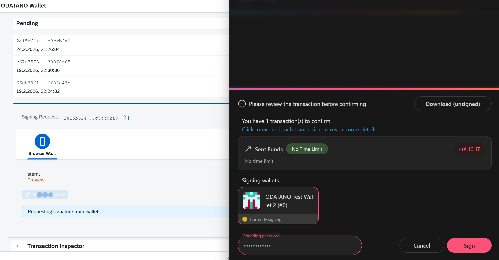

5. **Verify.** The app sends the signature to ODATANO with `SubmitVerifiedTransaction`. ODATANO adds it to
   the transaction and verifies it before it submits.

   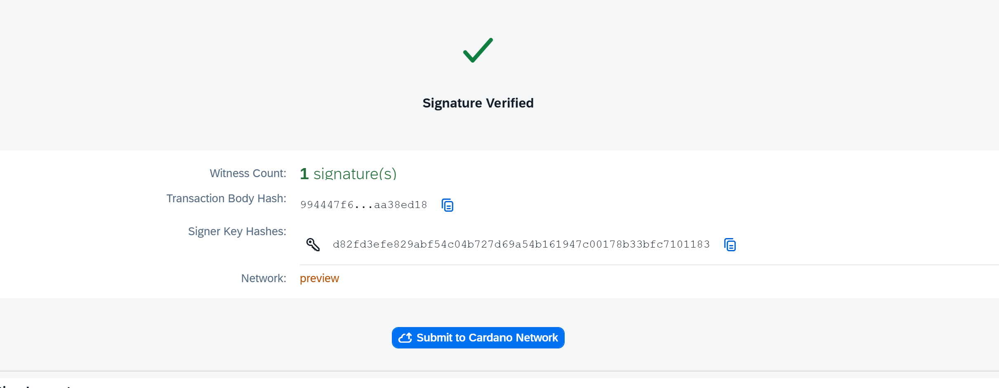

6. **Submit.** ODATANO submits the transaction and returns the transaction hash. The app shows it.

   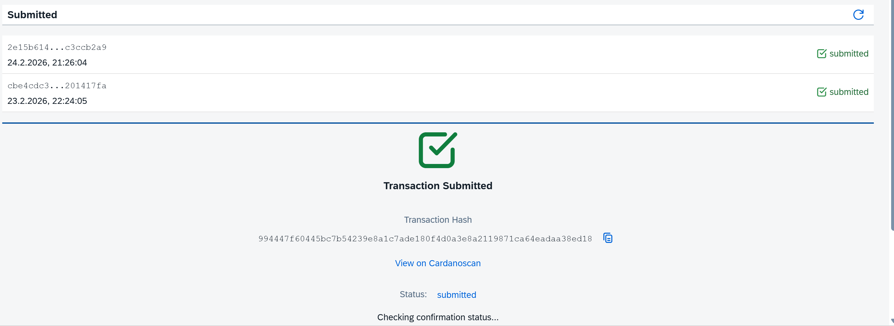

A transaction submitted this way from an ODATANO instance on SAP BTP:
https://preview.cardanoscan.io/transaction/994447f60445bc7b54239e8a1c7ade180f4d0a3e8a2119871ca64eadaa38ed18

## ABAP Integration

[ABAP Code Examples](../abap%20examples/README.md) has classes and templates that call the ODATANO
services from ABAP.

## Example Application: TRACE

TRACE is an example SAP Fiori application built on ODATANO. It tracks drug batches from the manufacturer
to the pharmacy. Each batch is an NFT with an on-chain datum. Each handoff between manufacturer,
distributor and pharmacy is a Plutus spend transaction. All transactions go through the ODATANO actions.

What TRACE uses:

- **Batch NFT minting** with an inline datum: `BuildMintTransaction`
- **Custody transfers** as Plutus spends: `BuildPlutusSpendTransaction`
- **Document anchoring**: hashes of certificates and cold-chain telemetry as CIP-20 metadata
- **CIP-30 wallet signing** with `SubmitVerifiedTransaction`
- **Parameterized validators** with `scriptParamsJson` and `lockOnScript`

GitHub: [https://github.com/ODATANO/TRACE](https://github.com/ODATANO/TRACE)
